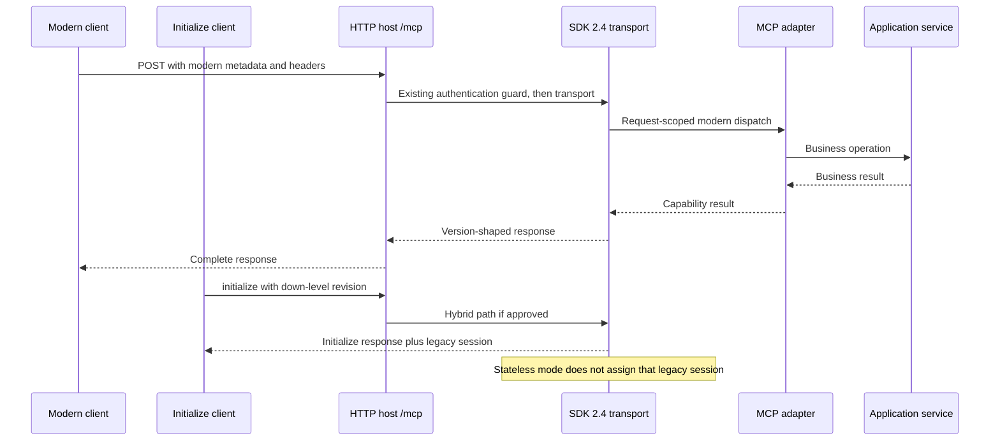

# Migration impact study: MCP 2026-07-28 / C# SDK 2.4.0

**Assessment date:** November 10, 2026. **Status:** proposal, not an implemented or qualified migration.
**Baseline:** repository `fc2b908280e530bf3bdc20bf3abe6ed346ed1d64`; published template `EasyMcp.McpServer.Template` 1.4.0.

## 1. Targets and evidence

Do not confuse the three version axes:

| Axis | Inspected baseline | Proposed target |
| --- | --- | --- |
| Template package | 1.4.0, embedding SDK 1.3.0 | Release number to be decided separately |
| SDK packages | `ModelContextProtocol` / `.AspNetCore` 1.3.0 | 2.4.0, stable release published November 7, 2026 |
| Protocol revision | SDK 1.3.0's newest revision is 2025-11-25; repository HTTP fixture uses 2025-06-18 | 2026-07-28, with explicit down-level interoperability |

The public NuGet template's embedded props and commit match the inspected baseline.[44]

The baseline SDK's newest protocol revision is 2025-11-25.[41]

The protocol `latest` endpoint resolves to 2026-07-28; GitHub's latest stable SDK release and NuGet's published version index agree on 2.4.0.[2][6][11]

Use the official C# SDK under `modelcontextprotocol/csharp-sdk`, not a different package or an unversioned draft.[42]

**Recommended direction:** move directly to stable SDK 2.4.0, retain .NET 10 and the current layered design, and explicitly select modern stateless HTTP for new projects. Existing generated projects are not required to migrate. Supply a simple manual guide for owners who choose to upgrade; hybrid HTTP is only an optional advanced path when they choose to retain session-dependent clients. This is not a commitment to migrate existing deployments or preserve every old behavior. These are recommendations awaiting approval, not edits made to the runtime.

## 2. Protocol changes: behavior, not just package versions

### Bootstrap and request metadata

Modern MCP removes `initialize` / `notifications/initialized` and uses per-request protocol/capability metadata. `server/discover` is the mandatory server discovery operation, not a replacement handshake that clients must always call first. HTTP also requires standard method/name headers, where applicable. Raw request examples, gateways, middleware and fixtures must be reviewed; the SDK should implement the wire behavior rather than the template maintaining a parallel protocol stack.[1][18]

### HTTP sessions and compatibility policy

Protocol 2026-07-28 removes transport sessions, `Mcp-Session-Id`, standalone GET/DELETE and resumability through `Last-Event-ID`. SSE can still carry the response to a POST: this is not removal of all SSE streaming. An interrupted request may need a new request ID; applications with side effects need their own deduplication/authorization policy rather than blind retries.[1][12]

The HTTP host currently calls `.WithHttpTransport()` without selecting a policy (`src/McpServer.Template.Host.Http/Program.cs:17-18`). SDK 2 changes that default from stateful to stateless. Choose explicitly:

| SDK 2.4 mode | Modern 2026-07-28 | Initialize-handshake peers | Intended use |
| --- | --- | --- | --- |
| `Stateless` | Native, no HTTP session | Supported without persistent sessions | Recommended new template default |
| `StatefulForInitializeClients` | Native stateless requests | Legacy clients receive sessions | Optional path for migrating owners retaining session-dependent clients |
| `Stateful` | Refused; a dual-era client may fall back | Legacy sessions | Temporary down-level operation, not native modern HTTP support |

`Stateless = false` means stateful-only, not hybrid. Set `SessionMode` explicitly and do not also assign the shorthand. Legacy `/sse` transport is separate and disabled by default; any temporary opt-in must be intentional and tested. It was already opt-in in SDK 1.3.0, so this is not a new 1.3-to-2.4 default change.[46]

Supporting 2025-11-25 or 2025-06-18 does not necessarily require the old `/sse` transport.[12][19][31]

### Results, schemas, caching and errors

Modern responses have `resultType` and cacheable results have `ttlMs` / `cacheScope`; tools may use any JSON Schema 2020-12 schema and structured results need not be objects. Missing resources use Invalid Params (`-32602`) rather than the legacy resource-not-found code. Header/version/capability errors have their own allocated codes. Assertions must distinguish the protocol era rather than replace every old fixture version string.[1][18]

The SDK handles version-dependent serialization and fills unset modern cache hints with zero TTL and private scope; positive caching is optional, not a prerequisite.[47]

Test that down-level peers do not receive incompatible modern-only fields. Custom clients and proxies must not assume a `{ result: ... }` wrapper for scalar structured output or deserialize tools without `inputSchema`. The two shipped tools return object DTOs and do not explicitly enable `UseStructuredContent`, so the scalar-wrapper change is conditional for customized applications, not an observed break in these tools. SDK 2.4 retains legacy schema/result wrapping for down-level peers; natural JSON applies to the modern path.[49]

### Interactions and notifications

Modern server-to-client interactions use MRTR: a tool can request more input and continue on a retry. Change notifications use `subscriptions/listen` rather than an independent GET stream. Roots, Sampling and protocol Logging are deprecated; removal of legacy operations is distinct from feature deprecation. Existing .NET application logging and Prometheus metrics are not deprecated by that statement. The current template does not implement these interactive features, so migration should not introduce them implicitly.[1][13][14]

### Proposed dual-era HTTP flow

## 3. SDK changes and applicability

| Change | Applicability here | Migration action |
| --- | --- | --- |
| Stateless HTTP default and discovery-first SDK clients in 2.0 | Direct | Explicit mode; modern + legacy integration tests [3] |
| Tasks moves to `ModelContextProtocol.Extensions.Tasks`, incompatible API/wire with 1.x experimental Tasks | Conditional: absent from template | Inventory consumer customizations; separate package/redesign if used [24] |
| Roots/Sampling/Logging diagnostics (`MCP9005`) and stateful-only options (`MCP9006`) | Conditional: no explicit feature use found | Do not blanket-suppress; choose a documented compatibility path |
| OAuth callback/issuer/PKCE, registration and token-cache hardening | Conditional: current `secure` mode is a placeholder, not SDK OAuth | Review callback replacement, issuer/PKCE, registration shape and repeated insufficient-scope challenges; the latter now fail instead of retrying indefinitely [3] |
| Structured scalar output and required tool `inputSchema` | Conditional | Test custom tools, clients, proxy JSON and fixtures |
| Changed explicit SSE connection exceptions | Client/integration code | Update catches that rely on the old IOException wrapper |
| `McpClient.ServerInfo` nullable in 2.3 | Conditional: template is server-side | Fix custom clients/harnesses with explicit null handling [32] |
| Modern HTTP headers wait for the first protocol message in 2.3 | Relevant to long-running custom tools and proxies | Verify timeouts/progress, cancellation and shutdown |
| 2.4 Apps protocol property casing and OAuth fallback opt-in | Optional Apps/custom OAuth consumers | Inspect those extensions only if used [4] |
| Experimental Skills package in 2.4 | Not a migration prerequisite | Keep out of the minimal scaffold and stable-core promises [25] |

These changes cross multiple release lines; 2.0 is not the latest target. Relevant 1.x maintenance releases also include HTTP session ownership hardening, an SSE memory-retention fix, and OAuth hardening. The 2.x stateful-session security fix was published in 2.3.1.[33]

A temporary 1.4.2 maintenance option is not adoption of the new protocol. No claim is made that the template's API-key guard establishes the authenticated principal required by upstream per-user session protections.[5][28][29]

### Authenticated legacy-session identity: an operational break to test

SDK 2.3.1 hardens authenticated stateful HTTP/legacy SSE sessions: authenticated principals need a nonempty `ClaimTypes.NameIdentifier`, `sub` or `ClaimTypes.Upn` from an authenticated identity. Session ownership compares claim type, value and issuer; invalid identity or a mismatch yields 403. Customized authentication may need claim mapping, not a disabled safety check. This is conditional for the current template because its shared-key gate does not set `HttpContext.User`.[45]

## 4. Dependency impact from published packages

Inspect actual `.nuspec` files, not just upstream test dependencies. SDK 2.4.0 still supplies `net10.0` assets, so no target-framework migration is required. Its package graph pins matching MCP components to 2.4.0. For net10.0, Core requires AI abstractions 10.11.0 and Logging abstractions 10.0.14; the hosting package requires Caching/Hosting abstractions 10.0.14. Current shared Microsoft versions are 10.0.7.[35][37][39]

Plan to reconcile `MicrosoftExtensionsVersion`, `MicrosoftExtensionsHostingVersion`, `MicrosoftExtensionsConfigVersion` and the HTTP test framework coherently with the resolved graph. Direct versions below transitive requirements risk downgrade/restore errors: the precise resolution is NOT established without `dotnet restore`. Keep .NET runtime/container servicing and unrelated test-library upgrades separate from assumptions about SDK protocol support. Open dependency PRs must be reconciled rather than merged opportunistically.

## 5. Repository impact map

- **Dependencies:** `Directory.Build.props:29-40`; MCP and both hosts' package references; Application/Infrastructure direct Microsoft dependencies participate in resolution even though their business code should not change.
- **HTTP:** explicit mode and discovery/protocol assertions; `Program.cs` metrics wrapper currently counts active requests under a session metric name. Clarify that metric when HTTP transport sessions disappear; do not silently relabel historical dashboards.
- **Stdio:** `Host.Stdio/Program.cs`, adapter DI and protocol integration. Suspected missing metrics-recorder registration must be reproduced as a baseline issue, not blamed on SDK 2. Verify stdout contains protocol messages only.
- **Adapters:** `Mcp/Extensions/ServiceCollectionExtensions.cs`, sample tools, prompts/resources and exception handling. The tagged 2.4 builder still exposes the current assembly-registration and stdio-transport APIs; no wholesale registration rewrite is indicated by source inspection. Compilation and wire behavior remain unqualified.[48]
- **Tests:** `Host.Http.Tests/McpProtocolBehaviorTests.cs` pins 2025-06-18, lacks a valid-session end-to-end path and uses broad status assertions. Retain meaningful legacy cases and add strict modern cases rather than merely changing constants. Supply a valid `Accept` header: the existing fixture omits it, so an observed rejection cannot safely be attributed to sessions alone.
- **Generated deliverable:** `.template.config/template.json`, `scripts/Test-Template.ps1`, `McpServer.Template.csproj`, both workflows and Docker. CI currently tests the sample solution/container, and the NuGet workflow packs/publishes on release; neither workflow runs the generated-project script. A release is not the right first opportunity to discover an invalid scaffold.
- **Published package gaps:** inspected template 1.4.0 contains the HTTP Dockerfile but no `.github` workflows or `THIRD_PARTY_NOTICES.md`, despite related documentation claims. Validate the actual candidate inventory and avoid promising generated CI. Independently scope fixes for no-host validation, stdio-only Docker output and sample-free welcome text if reproduced; these are pre-existing template concerns, not proven SDK regressions.[44]
- **Docs/context:** README, `docs/architecture.md`, `docs/configuration.md`, `docs/development.md`, `docs/operations.md`, `docs/capabilities.md`, `docs/template.md`, `openspec/config.yaml` and `openspec/project.md`. Correct “HTTP/SSE” ambiguity, outdated versions/defaults and over-broad SDK-isolation wording within approved scope. Review third-party attribution for the actual release assets.

## 6. Existing proposal reconciliation

- `add-quality-assurance-readiness`: reuse its broader QA intent; this migration owns a focused protocol/client/generated-project acceptance matrix.
- `add-http-secure-auth` and `add-http-security-hardening`: do not implement JWT/tenant/security infrastructure through the migration; identify impacted assumptions and keep the current guard's limits explicit.
- `add-observability-foundation`: reconcile request/session metric meaning and trace-context opportunities, without importing the entire observability project.
- `add-resilience-operations`: coordinate stream interruption/retry guidance; avoid promising resumability removed from modern MCP.
- `add-secure-configuration-governance`: coordinate new mode/config documentation if a public configuration surface is approved.

This proposal adds migration-specific capabilities. Before implementation, any actual changes to existing capability requirements require explicit delta specs; this study does not silently amend them.

## 7. Proposed acceptance matrix

The initial study had no local .NET SDK. A private SDK has since been installed, and the unchanged pre-migration solution now passes restore, Release build (0 warnings/errors) and all 84 existing tests. See the [baseline receipt](../../../docs/validation/pre-migration-baseline.md) for the exact tested commit, tooling notice and limits. This executes the existing-suite portion of row 1 only; candidate qualification, separate stdio reproduction and the remaining acceptance rows are **NOT RUN**. No migrated candidate binary exists.

1. Restore/build/test the old baseline and candidate; inspect downgrade warnings and new diagnostics separately.
2. Modern HTTP: discovery, correct headers/metadata, lists, tool calls, prompt/resource reads, no session ID, GET/DELETE behavior, unsupported-version and header-mismatch errors.
3. Legacy HTTP 2025-11-25 and 2025-06-18: successful initialize + normal calls, correct stateless/hybrid behavior, version-shaped responses; hybrid session lifecycle and owner boundaries where applicable.
4. Stdio: modern discovery, down-level initialize fallback, two tool invocations, prompt/resource operations, clean stdout, cancellation and graceful shutdown. Exercise the actual client SDK, not only methods directly.
5. Serialization/cache: output schemas, object/scalar custom fixtures, resultType, TTL/scope defaults and dynamic status freshness, deterministic lists, missing-resource errors.
6. Authentication/configuration: none/simple guard continuity, custom header, invalid credentials and monitoring endpoints; secure remains explicitly unimplemented. For authenticated legacy sessions, test missing/empty identifiers, owner/issuer mismatches and valid owner continuation. Real OAuth only if a separately scoped consumer fixture exists.
7. Pack/install the candidate template in an isolated template engine; generate HTTP-only/stdio-only/both, samples on/off and tests on/off. Enumerate valid combinations and separately test no-host rejection; build, run tests where present and exercise generated hosts.
8. Rehearse the guide using the published 1.4.0 package, not only a copy of main; verify a customized fixture retains user logic. Include proxy/header/timeout behavior and rollback to a previously qualified immutable deployment.
9. Do not claim broad client compatibility from one SDK integration. Record exact external client versions as available, plus untested clients.

## 8. Consumer migration and release boundary

The [draft migration guide](../../../docs/migrations/mcp-2026-07-28.md) is part of this study. Existing projects are owned source, not runtime consumers of the template NuGet package: updating the template does not patch generated files. Migration is voluntary. For owners who opt in, the deliverable is a simple step-by-step guide explaining the files to change, commands to run, checks and rollback. Advanced compatibility cases are a separate reference, not universal migration requirements. Choosing not to migrate does not imply a maintenance or security-support promise. A voluntary migration requires a manual, reviewed application diff, tests and a rollback point. A fresh scaffold is an optional comparison artifact, not an instruction to overwrite the application.

A template release number, support policy for 1.x consumers, actual client test targets and HTTP mode approval remain open. A breaking template behavior deserves explicit release notes and a versioning decision; the template version must not simply be copied from the SDK. There is no authorized merge, release, deployment, external service or paid call.

## 9. Deferred feature showcase roadmap

Track separately after the core migration is qualified:

- **Core onboarding:** show native discovery, explicit stateless HTTP and protocol-era compatibility clearly.
- **Caching/schema examples:** deterministic lists, safe cache metadata, public static welcome versus uncached/private dynamic status, and rich structured schemas without breaking current sample output unexpectedly.
- **Interactive example:** one small MRTR elicitation flow with decline/cancel and replay safety; compatible clients and fallback documented.
- **Notifications:** opt-in `subscriptions/listen` example with cleanup and cancellation, not an always-open legacy GET stream. SDK 2.1 adds the public handler.[30]
- **Extensions:** assess Tasks for long-running operations and Apps for embedded UI in distinct proposals/packages. Their existence does not make either mandatory core protocol functionality.[24][26]
- **Experimental:** evaluate Skills only as an explicitly experimental opt-in, separate from stable onboarding. Do not advertise new Roots/Sampling/protocol-Logging examples as recommended modern features.[1][25]

## Verification receipt

Official revisions/releases, versioned SDK source and published NuGet metadata were retrieved; the published template baseline was inspected. Static analysis and documentation/OpenSpec validation were completed. The subsequent [pre-migration baseline](../../../docs/validation/pre-migration-baseline.md) also establishes a successful Release build and 84 passing existing tests with SDK 1.3.0 unchanged. Migrated-candidate compilation, runtime protocol conformance, generated-project execution, external-client interoperability and deployment remain unqualified.

## Sources

[1] https://modelcontextprotocol.io/specification/2026-07-28/changelog — protocol-changelog
[2] https://modelcontextprotocol.io/specification/latest — protocol-latest
[3] https://api.github.com/repos/modelcontextprotocol/csharp-sdk/releases/tags/v2.0.0 — sdk-release-2.0
[4] https://api.github.com/repos/modelcontextprotocol/csharp-sdk/releases/tags/v2.4.0 — sdk-release-2.4
[5] https://api.github.com/repos/modelcontextprotocol/csharp-sdk/releases/tags/v1.4.2 — sdk-release-1.4.2
[6] https://api.github.com/repos/modelcontextprotocol/csharp-sdk/releases/latest — sdk-release-latest
[11] https://api.nuget.org/v3-flatcontainer/modelcontextprotocol/index.json — nuget-sdk
[12] https://raw.githubusercontent.com/modelcontextprotocol/csharp-sdk/v2.4.0/docs/concepts/stateless/stateless.md — docs/concepts/stateless/stateless.md
[13] https://raw.githubusercontent.com/modelcontextprotocol/csharp-sdk/v2.4.0/docs/concepts/transports/transports.md — docs/concepts/transports/transports.md
[14] https://raw.githubusercontent.com/modelcontextprotocol/csharp-sdk/v2.4.0/docs/concepts/mrtr/mrtr.md — docs/concepts/mrtr/mrtr.md
[18] https://raw.githubusercontent.com/modelcontextprotocol/csharp-sdk/v2.4.0/src/Common/McpProtocolVersions.cs — src/Common/McpProtocolVersions.cs
[19] https://raw.githubusercontent.com/modelcontextprotocol/csharp-sdk/v2.4.0/src/ModelContextProtocol.AspNetCore/HttpServerTransportOptions.cs — src/ModelContextProtocol.AspNetCore/HttpServerTransportOptions.cs
[24] https://raw.githubusercontent.com/modelcontextprotocol/csharp-sdk/v2.4.0/docs/concepts/tasks/tasks.md — docs/concepts/tasks/tasks.md
[25] https://raw.githubusercontent.com/modelcontextprotocol/csharp-sdk/v2.4.0/docs/concepts/skills/skills.md — docs/concepts/skills/skills.md
[26] https://raw.githubusercontent.com/modelcontextprotocol/csharp-sdk/v2.4.0/docs/concepts/apps/apps.md — docs/concepts/apps/apps.md
[28] https://api.github.com/repos/modelcontextprotocol/csharp-sdk/releases/tags/v1.4.0 — sdk-release-1.4.0
[29] https://api.github.com/repos/modelcontextprotocol/csharp-sdk/releases/tags/v1.4.1 — sdk-release-1.4.1
[30] https://api.github.com/repos/modelcontextprotocol/csharp-sdk/releases/tags/v2.1.0 — sdk-release-2.1.0
[31] https://api.github.com/repos/modelcontextprotocol/csharp-sdk/releases/tags/v2.2.0 — sdk-release-2.2.0
[32] https://api.github.com/repos/modelcontextprotocol/csharp-sdk/releases/tags/v2.3.0 — sdk-release-2.3.0
[33] https://api.github.com/repos/modelcontextprotocol/csharp-sdk/releases/tags/v2.3.1 — sdk-release-2.3.1
[35] https://api.nuget.org/v3-flatcontainer/modelcontextprotocol/2.4.0/modelcontextprotocol.2.4.0.nupkg — modelcontextprotocol 2.4.0 published package metadata
[37] https://api.nuget.org/v3-flatcontainer/modelcontextprotocol.core/2.4.0/modelcontextprotocol.core.2.4.0.nupkg — modelcontextprotocol.core 2.4.0 published package metadata
[39] https://api.nuget.org/v3-flatcontainer/modelcontextprotocol.aspnetcore/2.4.0/modelcontextprotocol.aspnetcore.2.4.0.nupkg — modelcontextprotocol.aspnetcore 2.4.0 published package metadata
[41] https://raw.githubusercontent.com/modelcontextprotocol/csharp-sdk/v1.3.0/src/ModelContextProtocol.Core/McpSessionHandler.cs — sdk-1.3-utils
[42] https://raw.githubusercontent.com/modelcontextprotocol/csharp-sdk/v2.4.0/README.md — sdk-readme
[44] https://api.nuget.org/v3-flatcontainer/easymcp.mcpserver.template/1.4.0/easymcp.mcpserver.template.1.4.0.nupkg — Published template 1.4.0 contents
[45] https://api.github.com/repos/modelcontextprotocol/csharp-sdk/commits/bfbd8936c0575c3cce875fbe6adb7d305a0dec87 — auth-session-security-commit
[46] https://raw.githubusercontent.com/modelcontextprotocol/csharp-sdk/v1.3.0/src/ModelContextProtocol.AspNetCore/HttpServerTransportOptions.cs — http-options-1.3
[47] https://raw.githubusercontent.com/modelcontextprotocol/csharp-sdk/v2.4.0/src/ModelContextProtocol.Core/Server/McpServerImpl.cs — server-shaping-2.4
[48] https://raw.githubusercontent.com/modelcontextprotocol/csharp-sdk/v2.4.0/src/ModelContextProtocol/McpServerBuilderExtensions.cs — primitive-builder-2.4
[49] https://raw.githubusercontent.com/modelcontextprotocol/csharp-sdk/v2.4.0/src/ModelContextProtocol.Core/Server/AIFunctionMcpServerTool.cs — structured-tools-2.4
